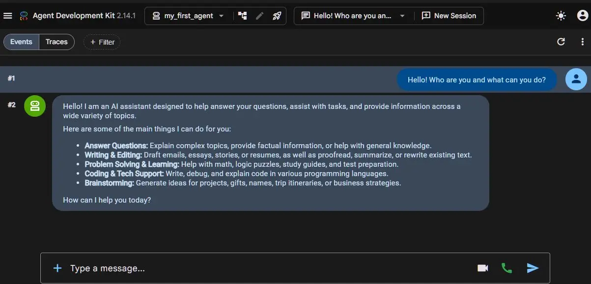

# First Agent - Google Agent Development Kit (ADK)

First AI agent built with Google's Agent Development Kit (ADK) on the Gemini platform (Google AI Studio).

Developed based on the course "Build Your First Agent with Agent Development Kit (ADK)" on Google Skills.

## Tech Stack

* **Framework:** Google Agent Development Kit (`google-adk`)
* **Platform:** Gemini Platform (Google AI Studio API)
* **Model:** `gemini-3.5-flash`
* **Language:** Python 3.15.2
* **Package Manager:** `uv`

## Prerequisites

* `uv` installed
* A Google AI Studio API key

## Project Structure

```text
my_first_agent/
├── assets/
│   └── img/
│       └── adk-agente-1.webp # ADK Web UI verification screenshot
├── __init__.py               # Package initialization
├── agent.py                  # Root agent definition and model configuration
├── .env.example              # Environment variables template
├── .gitignore                # Git exclusion rules
└── README.md                 # Project documentation
```

## Local Setup and Execution

Run all commands from the parent directory of `my_first_agent/`.

1. Create and activate the virtual environment:

   ```bash
   uv venv --python 3.15.2 .venv
   source .venv/bin/activate
   ```

2. Install dependencies:

   ```bash
   uv pip install google-adk
   ```

3. Configure environment variables:

   ```bash
   cp my_first_agent/.env.example my_first_agent/.env
   ```

   Edit `my_first_agent/.env` and set:

   ```text
   GOOGLE_GENAI_USE_VERTEXAI=FALSE
   GOOGLE_API_KEY=your_api_key_here
   ```

   > Never commit `.env`; make sure it is listed in `.gitignore`.

4. Run the ADK web interface:

   ```bash
   adk web
   ```

   Open `http://localhost:8000` and select `my_first_agent` in the top-left dropdown.

   > `adk web` is for development and debugging only, not production.

## Verification

ADK Web UI running the agent:

